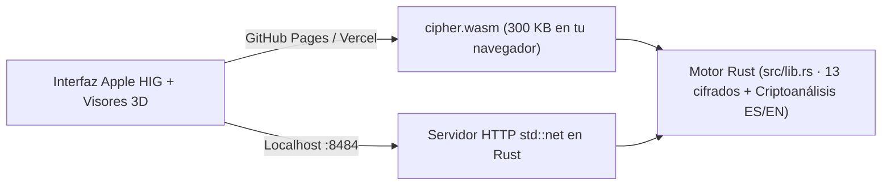

# Cipher Studio · Criptografía Clásica y Moderna 3D en Rust

> **Demo en vivo (100% WebAssembly en tu navegador):** **https://ivanljprof-ai.github.io/cipher-studio-rust/**

[](https://ivanljprof-ai.github.io/cipher-studio-rust/)
[](Cargo.toml)
[](docs/cipher.wasm)
[](Cargo.toml)
[](LICENSE)

Suite interactiva de **18 algoritmos criptográficos** (13 cifrados clásicos/esteganografía + **DES, 3DES, IDEA, AES-128/192/256 y MD5**) escrita íntegramente en **Rust puro** (cero crates externos), con estética clara Apple HIG, objetos 3D manipulables en tiempo real y retos multinivel en español e inglés.

---

## Arquitectura Dual: WebAssembly + Servidor Nativo



- **En la web pública (GitHub Pages / Vercel)**: Tu propio navegador ejecuta `docs/cipher.wasm` compilado a `wasm32-unknown-unknown`. Ningún dato sale de tu dispositivo.
- **En local**: `cargo run --release` levanta un servidor TCP multihilo en `http://127.0.0.1:8484` usando solo `std`.

---

## Los 13 Algoritmos, Visores 3D y Criptoanálisis

| # | Cifrado | Categoría | Objeto / Visor Interactivo | Cómo lo resuelve Rust |
|---:|---|---|---|---|
| 1 | **César** | Sustitución | Teclas interactivas `A–Z` | Fuerza bruta (26 rotaciones) + scoring ES/EN |
| 2 | **Atbash** | Sustitución | Tabla especular `A⇄Z` | Involución simétrica directa |
| 3 | **Pigpen** | Sustitución | Glifos SVG + teclado masónico 3D | Detección y decodificación geométrica |
| 4 | **Disco de Alberti** | Polialfabético | Disco dual 3D arrastrable + simulador | Búsqueda sobre 26 índices × 7 cadencias |
| 5 | **Vigenère** | Polialfabético | Espectro 3D Índice de Coincidencia | Test IC de Friedman + correlación por columna |
| 6 | **Playfair** | Polialfabético | Cubos `5×5` + trazador de dígrafos 3D | Diccionario + Hill-Climbing `5×5` |
| 7 | **Cilindro de Jefferson** | Rotores | Tambor 3D de 36 discos orbitable | Ranking de las 25 generatrices paralelas |
| 8 | **Escítala Espartana** | Transposición | Vara poligonal 3D giratoria + slider | Fuerza bruta de diámetro (`2..20` caras) |
| 9 | **Rail Fence** | Transposición | Onda zig-zag animada + `−/+` raíles | Fuerza bruta (`2..12` raíles) |
| 10 | **Transposición Columnas** | Transposición | Columnas elevables en 3D | Fuerza bruta de permutaciones (hasta 6 cols) |
| 11 | **Rejilla de Cardano** | Transposición | Placa 3D `0°/90°/180°/270°` + órbitas | Evaluación de plantillas + penalización de huecos |
| 12 | **Tinta Invisible** | Esteganografía | Linterna UV que sigue al cursor | Escáner binario Zero-Width (`U+200B..U+FEFF`) |
| 13 | **Acrósticos** | Esteganografía | Versos con iniciales resaltadas | Extracción simultánea (acróstico, notarikon, teléstico, mesóstico) |
| 14 | **DES (64-bit)** | Bloques Simétrico | Red Feistel 16 rondas (L/R/K) | Auditoría de claves conocidas + verificación PKCS#7 |
| 15 | **3DES (EDE)** | Bloques Simétrico | Pipeline 3D `E(K1)→D(K2)→E(K3)` | Descifrado EDE inverso con claves de 168/112 bits |
| 16 | **IDEA (128-bit)** | Bloques Simétrico | Rondas mod `65537`/`65536`/`XOR` | Inversos multiplicativos/aditivos por subclave |
| 17 | **AES (128/192/256)** | Bloques Moderno | Matriz de estado `4×4` 3D por ronda | Descifrado FIPS 197 + auditoría de diccionario |
| 18 | **MD5 (RFC 1321)** | Hash 128-bit | Registros `(A, B, C, D)` + avalancha | Cracker de diccionario + PINs `0000–9999` en Rust |

---

## Uso y Compilación Local

```bash
# Clonar el repositorio
git clone https://github.com/ivanljprof-ai/cipher-studio-rust.git
cd cipher-studio-rust

# Ejecutar las 16 pruebas unitarias y Clippy
cargo test
cargo clippy --all-targets -- -D warnings

# Arrancar servidor nativo en http://127.0.0.1:8484
cargo run --release

# Recompilar el módulo WebAssembly para GitHub Pages / Vercel
rustup target add wasm32-unknown-unknown
cargo build --lib --release --target wasm32-unknown-unknown
cp target/wasm32-unknown-unknown/release/cifrados_rust.wasm docs/cipher.wasm
cp static/index.html docs/index.html
```

---

## Estructura del Proyecto

- [`src/lib.rs`](src/lib.rs): Motor de los 13 cifrados, scoring heurístico ES/EN, presets multinivel, parser JSON y puente WASM.
- [`src/main.rs`](src/main.rs): Servidor HTTP multihilo sin dependencias (`std::net::TcpListener`).
- [`static/index.html`](static/index.html): Interfaz Apple HIG clara + objetos 3D interactivos.
- [`docs/`](docs/): Paquete estático (`index.html` + `cipher.wasm`) servido por GitHub Pages y Vercel.
- [`vercel.json`](vercel.json): Configuración directa para despliegue en Vercel.
